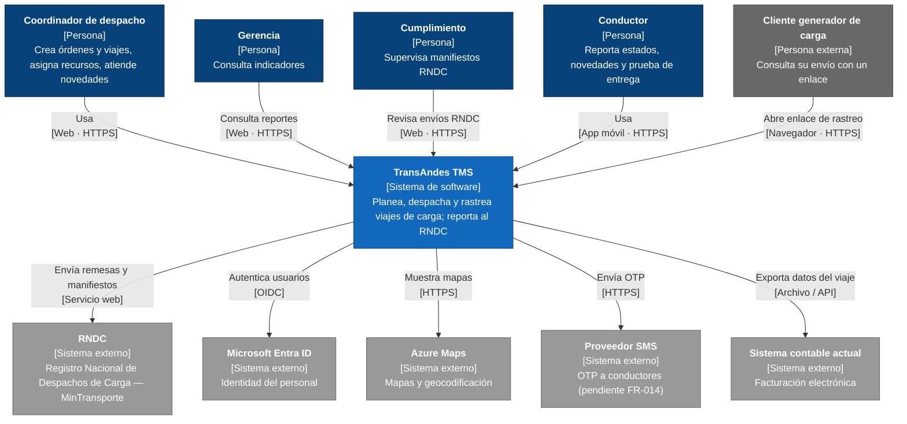

# C4 nivel 1 — Diagrama de contexto

Muestra TransAndes TMS como una caja negra: quién lo usa y con qué sistemas externos se integra.

> Notación C4 dibujada con `flowchart` de Mermaid (la sintaxis `C4Context` de Mermaid es experimental y su
> distribución automática superpone etiquetas). Colores C4 estándar: persona azul oscuro, sistema propio azul,
> externos gris.

## Notas

- El **RNDC** es la dependencia crítica: su mecanismo técnico exacto está pendiente de confirmar con el
  Ministerio de Transporte (`research.md` R1).
- El **cliente** no tiene cuenta en el MVP; solo usa el enlace público (portal con cuenta en fase 2).
- La **facturación electrónica** sigue en el sistema contable; el TMS solo le entrega los datos del viaje.
