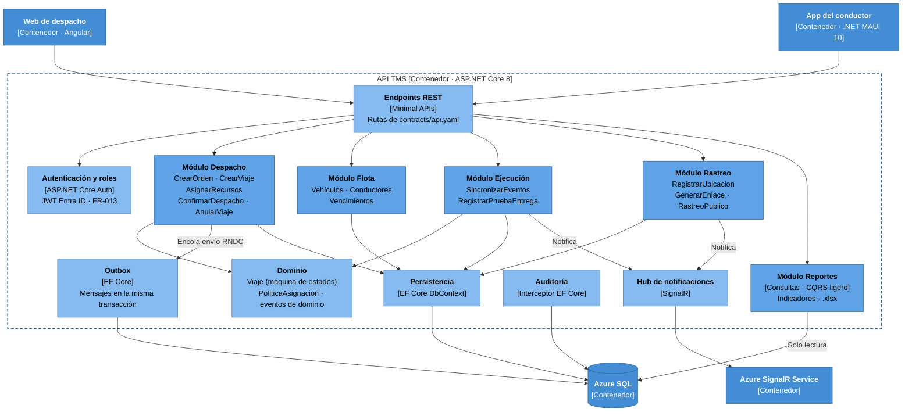
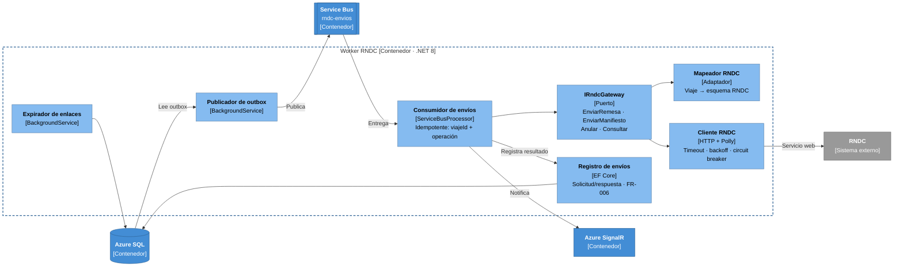

# C4 nivel 3 — Diagrama de componentes

Zoom dentro de la **API TMS** y el **Worker RNDC**. Cada componente es un módulo con una responsabilidad clara;
el código vive en los proyectos de `plan.md` (`Api`, `Application`, `Domain`, `Infrastructure`, `Rndc`, `Workers`).

## 3.1 API TMS

## 3.2 Worker RNDC

## Reglas de dependencia

- `Domain` no depende de nada. `Application` depende solo de `Domain` y de puertos (interfaces).
- `Infrastructure` y `Rndc` implementan los puertos; `Api` y `Workers` componen todo con inyección de dependencias.
- Un módulo no accede a las tablas de otro módulo: se comunica por casos de uso o eventos de dominio.
- Se valida en CI con pruebas de arquitectura (p. ej. NetArchTest).
