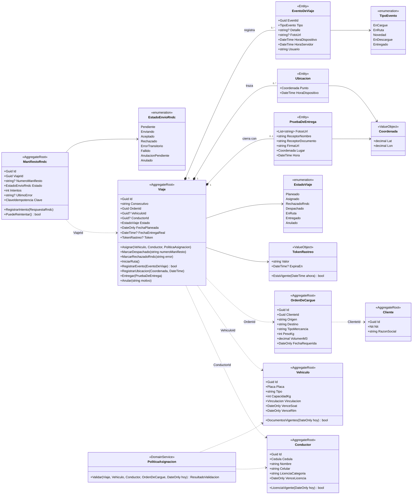
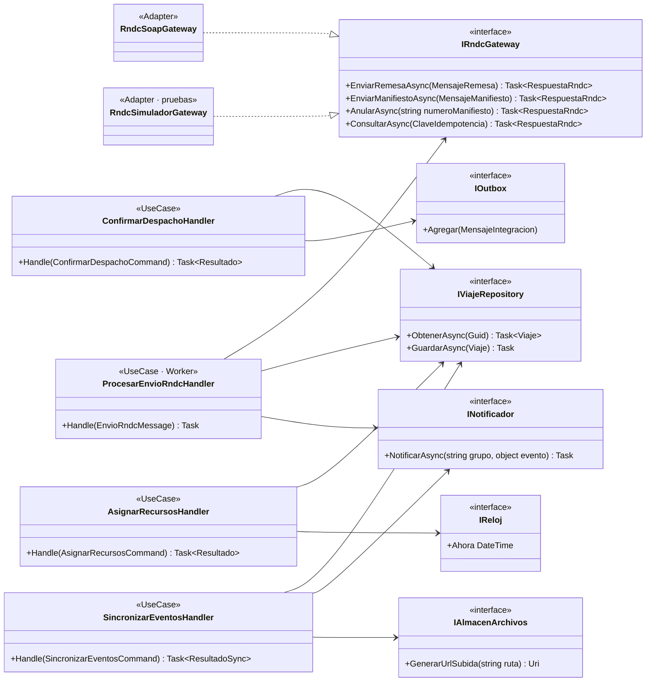

# Diagrama de clases

Modelo de dominio (DDD táctico) alineado con [`data-model.md`](../../specs/001-despacho-rastreo-mvp/data-model.md).
Equivale al nivel 4 (código) del modelo C4 para el núcleo del sistema.

## 4.1 Modelo de dominio

**Agregados**: `Viaje` (raíz; contiene eventos, ubicaciones y prueba de entrega), `ManifiestoRndc`,
`Vehiculo`, `Conductor`, `Cliente`, `OrdenDeCargue`. Entre agregados solo se referencian identificadores.

### Invariantes del agregado `Viaje`

1. Solo se asigna en `Planeado` y si `PoliticaAsignacion` aprueba (documentos vigentes, capacidad ≥ peso, recursos libres).
2. `Despachado` exige número de manifiesto aceptado por el RNDC (Principio II).
3. `RegistrarEvento` devuelve `false` si el `EventId` ya existe (idempotencia, FR-007).
4. `Entregado` exige `PruebaDeEntrega` completa (FR-008) y fija `TokenRastreo.ExpiraEn = entrega + 30 días`.
5. Anular desde `Despachado` o `EnRuta` exige anulación previa en el RNDC.

## 4.2 Puertos y casos de uso (capa de aplicación)

> `RndcSoapGateway` es un nombre provisional: el protocolo real depende de la aclaración pendiente sobre el
> mecanismo técnico del RNDC. El puerto no cambia.
