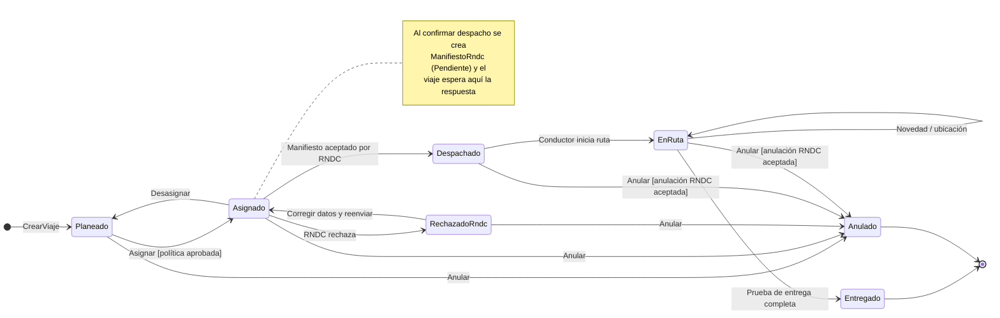
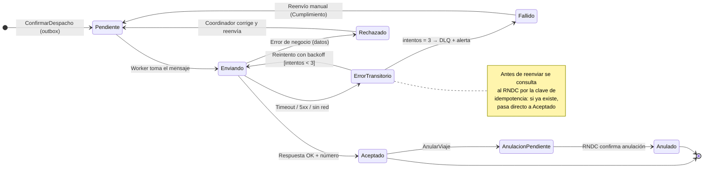
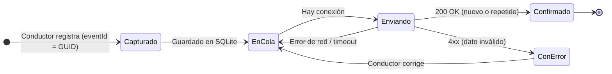

# Diagramas de estado

## 5.1 Ciclo de vida del Viaje

Fuente de verdad: `Viaje` en el dominio. Toda transición queda auditada (FR-011).

| Transición | Guarda | Efecto |
|------------|--------|--------|
| Planeado → Asignado | Documentos vigentes, capacidad ≥ peso, recursos libres | Vehículo y conductor quedan ocupados |
| Asignado → Despachado | Manifiesto `Aceptado` | Se guarda el número; se genera `TokenRastreo`; la app recibe el viaje |
| Asignado → RechazadoRndc | Manifiesto `Rechazado` | Mensaje legible al coordinador (SignalR) |
| EnRuta → Entregado | Prueba de entrega con fotos, receptor y firma | `TokenRastreo` expira en 30 días; recursos se liberan |
| Despachado/EnRuta → Anulado | Anulación aceptada en RNDC | Recursos se liberan |

## 5.2 Envío al RNDC (`ManifiestoRndc`)

Garantiza **cero manifiestos duplicados** aunque haya reintentos o caídas del RNDC.

## 5.3 Evento offline en la app del conductor

Los adjuntos (fotos, firma) se suben a Blob con URL SAS **antes** de enviar el evento; el evento solo lleva
la URL. Si la subida falla, el evento permanece `EnCola`.
