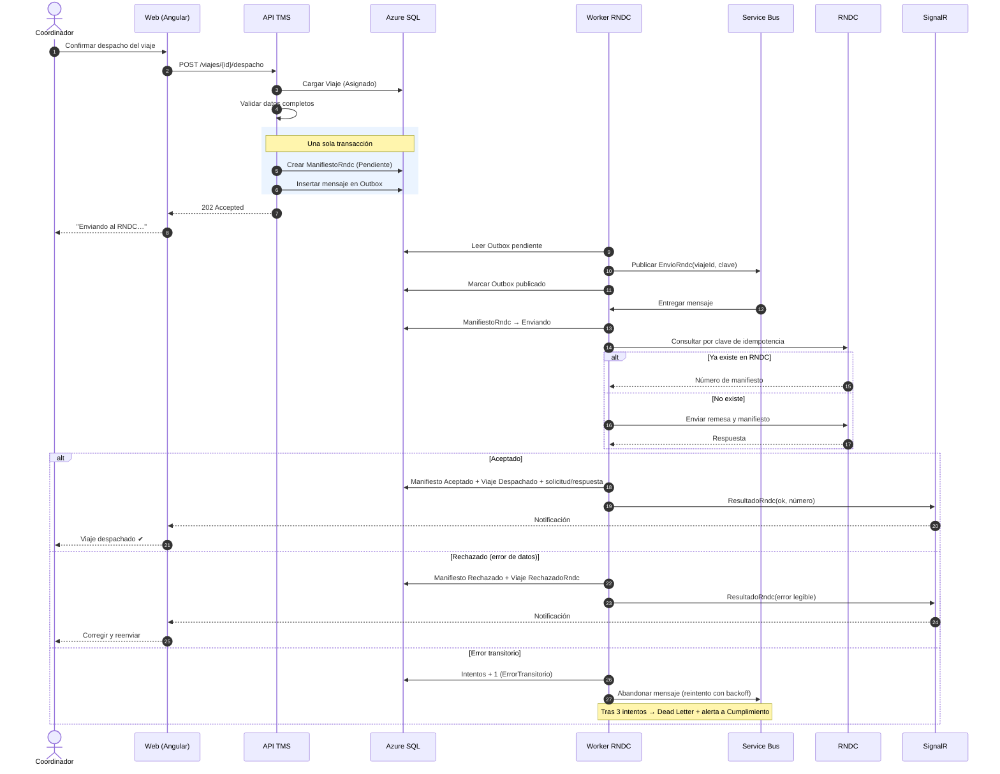
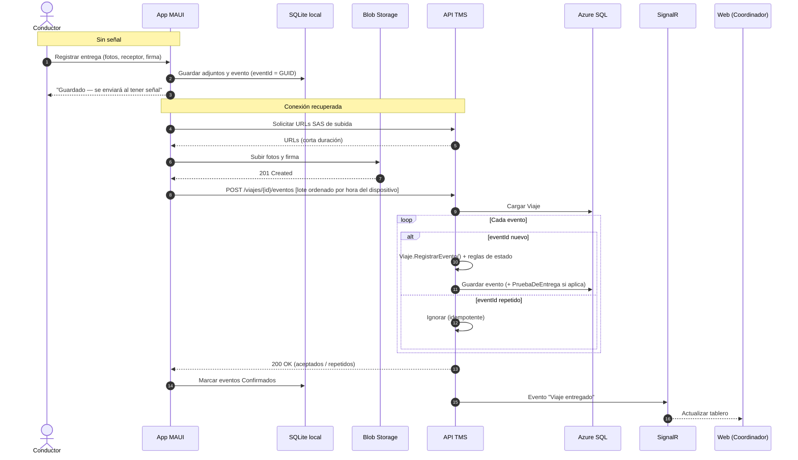
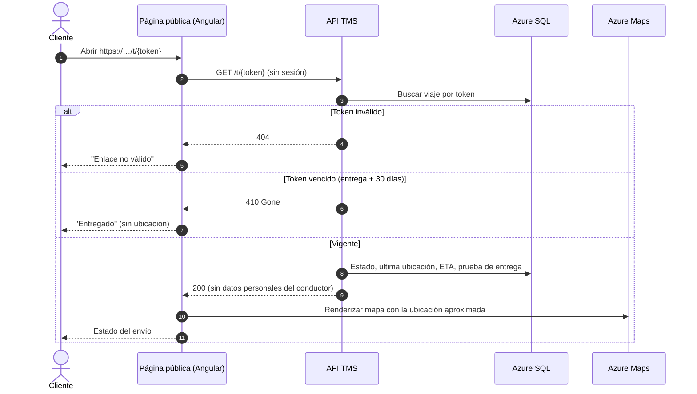

# Diagramas de secuencia

## 6.1 Confirmar despacho y reportar al RNDC (US2)

Patrón **Transactional Outbox**: el cambio de estado y el mensaje se guardan en la misma transacción;
el coordinador no espera al RNDC.

## 6.2 Sincronización offline de eventos y prueba de entrega (US3)

## 6.3 Rastreo público del cliente (US4)

Controles: token aleatorio de 128 bits, limitación de tasa por IP en Front Door, sin cédula ni celular del
conductor en la respuesta, y fotos de entrega servidas con SAS de corta duración.
